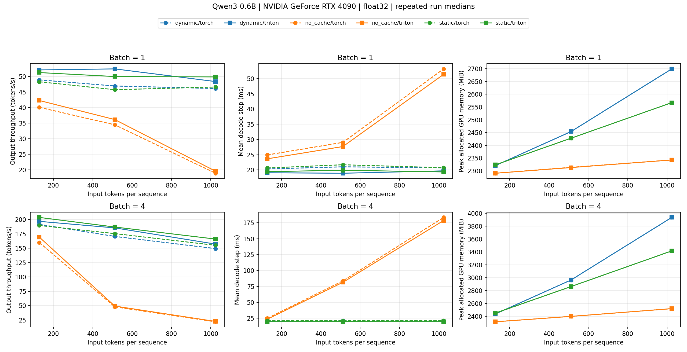

# RTX 4090 实测：从 KV Cache 到 Triton RMSNorm

日期：2026-10-21。模型为本地 Qwen3-0.6B，设备为一张 RTX 4090（24 GB）。不是线上服务压测，也没有多卡或生产质量结论。

## 结果先看这里

| 实验 | 基线 → 候选 | 实测结果 | 如何解读 |
| --- | --- | --- | --- |
| FP32，B=4，输入 1024，输出 32 | no_cache/torch → dynamic/torch | 21.873 → 149.316 tokens/s，6.826× | 避免逐步重算完整前缀；不是相对 vLLM 的提升 |
| 同上 | dynamic/torch → static/torch | 149.316 → 155.081 tokens/s，1.039× | 小幅整体差异；也包含不同 SDPA 分支的影响 |
| FP32，B=1，输入 512，输出 32，独立十次复测 | dynamic/torch → dynamic/triton | 49.282 → 53.433 tokens/s，+8.423% | 在相同动态缓存路径中替换 RMSNorm，非生产吞吐 |
| BF16 RMSNorm，矩阵形状 512×2048 | eager / compile / Triton | 37.285 / 7.017 / 4.548 μs | 算子实验，不能与上一行的端到端倍数混用 |

正式扫描为 2 个 batch × 3 个输入长度 × 3 种缓存 × 2 种 Norm × 5 次重复，即 **180 条原始测量**，没有 OOM。独立复测追加 40 条；算子实验为 12 种形状 × 3 种实现，各测 3 轮。算子单轮采用 Triton `do_bench` 的默认均值统计，再取三轮中位数，排除初始编译与预热。



完整数据：[推理报告](inference/report.md)、[原始推理 JSON](inference/measurements.json)、[CSV](inference/summary.csv)、[复测 JSON](20261021-confirm-fp32.json)、[算子报告](kernel/report.md)、[算子原始 JSON](kernel/measurements.json)。图表展示方式更新过，原始测量未修改。

## 环境与出处

- Python 3.11.16；PyTorch 2.11.0+cu128；CUDA runtime 12.8；Transformers 4.57.6；Triton 3.6.0；驱动 595.99.02。
- GPU 物理编号 1，UUID `GPU-525e2e74-7f40-caf7-ad9f-bf067ed324b4`，通过 `CUDA_VISIBLE_DEVICES=1` 映射为逻辑 cuda:0。未改 GPU 时钟或终止其他作业。
- 模型权重不进入 Git，文件指纹在 [model-sha256.txt](model-sha256.txt)。模型路径可用 `PRO_AI_MODEL` 或 `--model` 替换。
- 正式性能与精度测量源码：`6eb05740822544f35f477d27803b0f4785b229ab`，开始时工作区干净；后续增加布局诊断和图表展示，未改动这些性能数据。
- 最终 CPU/GPU 回归测试：**52 passed**。本机 CPU 回归为 42 passed / 10 个 GPU 测试跳过。GitHub Actions 执行离线 CPU 测试，不声称托管 runner 有 GPU。

## 正确性验收与失败案例

[FP32 门禁](correctness-fp32.json) 使用 B=1、初始 128 token、追加 8 个固定 token。每个缓存模式比较 9 个位置：

| 实现 | 最大绝对 logits 误差 | 结果 |
| --- | --- | --- |
| Torch + DynamicCache | 3.1471e-5 | 通过 |
| Torch + StaticCache | 2.3365e-5 | 通过 |
| Triton + DynamicCache | 2.6703e-5 | 通过 |
| Triton + StaticCache | 2.1935e-5 | 通过 |
| 同一完整前向中 Torch Norm → Triton Norm | 1.4305e-5；替换 113 个模块 | 通过 |

以上阈值均为 atol=rtol=1e-4；是指定固定输入的一致性验证，不是对所有提示词的形式证明。

另有一条 [中文提示词生成验收](20261021-generation-sample.json)：三种缓存 × 两种 Norm 的 24 个生成 token 完全一致。这只是补充检查，不能替代 logits 校验。该例固定长度、忽略 EOS，模型回答结束后仍可能继续生成角色文本，不代表聊天产品体验或质量通过。

较大输入 B=4、L=512、追加 8 token 的 [FP32 检查](20261021-fp32-b4-l512.json) 也通过，最大误差 4.2915e-5。但是，同一输入的 [BF16 检查](20261021-bf16-diagnostic.json) **未通过** atol=rtol=0.05：最大绝对误差 0.291015625，在长度 517 时 top-1 一致率为 0.75。不能将 BF16 路径写成“完全等价”或以文字相似证明正确。

### 为什么连第一次 Prefill 都可能不同？

[独立干预实验](20261021-attention-layout-bf16-v2.json) 捕获到如下首层 SDPA 调用；这不是缓存内容损坏的直接证据：

| 原始路径 | Mask | GQA | SDPA 接收的 K/V 头数 | Prefill 相对 no-cache 的最大 logits 误差 |
| --- | --- | --- | --- | --- |
| no_cache | 显式 [4,1,512,512] | false | 16（已展开） | 0 |
| dynamic | 无显式 mask，is_causal=true | true | 8 | 0.21875 |
| static（容量恰好 512） | 显式 [4,1,512,512] | false | 16（已展开） | 0 |

同一路径重复运行 no-cache 的误差为 0。只令 Q/K/V 连续，动态缓存误差仍为 0.21875，**没有解决差异**；将各路径都统一为显式 causal mask、展开 K/V 头、禁用原生 GQA 并连续化后，本次 Prefill 误差变为 0。

这支持“框架 Attention 分支/执行方式参与了 Prefill 的数值差异”，而不能将问题仅归结为增量输入长度变化。干预同时改变多个执行条件，尚未隔离到某个硬件 kernel；没有据此修改正式推理，也没有宣称解决后续 BF16 Decode 或模型质量。

## 性能分析带来的判断

[dynamic/torch 摘要](dynamic.txt)、[static/torch 摘要](static.txt)、[dynamic/triton 摘要](dynamic-triton.txt) 使用 FP32、B=1、L=512、生成 8 token，单独开启 Profiler，不将其耗时当正式测速。

- Torch 动态路径中有 904 次 `aten::mean`；Triton 路径出现 904 次 `_rms_norm`，对应 113 个 Norm × 8 次前向。`aten::mul` 从 3392 次降至 1584 次。证据与减少归一化中间操作的设计一致。
- 矩阵乘 `aten::mm` 仍为 1576 次，约 36.5–36.7 ms 的 self CUDA 时间。RMSNorm 融合没有消除投影/MLP，所以完整推理不会获得算子微基准的 8 倍收益。
- 静态路径摘要出现 `_efficient_attention_forward`，动态路径则包含 GQA/math 路径的 `bmm` 等操作。**相同 `--attention sdpa` 不等于相同底层 kernel**，不能把二者全部差值归功于预分配或消除拼接。
- 摘要中的 `prefill/decode` 是范围注释；某些 CUDA 百分比会超过 100%，不要将嵌套范围、算子和 kernel 行相加成一份占比饼图。这里用调用次数和具体事件解释现象，用独立 benchmark 给出最终速度。

Torch Norm 下，静态缓存相对动态缓存的整体吞吐在各配置约为 0.974–1.039×，没有稳定的显著优势。B=4、L=1024 时，动态/静态缓存峰值 allocated 分别约 3935.5/3416.1 MiB；这是整个推理中的峰值，含权重、临时张量和不同 Attention 执行路径，不应写成“纯 KV 存储减少 13%”。两者同容量下的理论 KV 字节数相同。

## 波动与适用范围

正式扫描 36 个分组中有 1 组吞吐 CV > 10%（B=4、L=128、static/triton），数据没有删除。共享服务器上还有其他 GPU 作业；GPU 初始/结束快照保存在原始 JSON 中，不能排除主机负载、温度、功耗和时钟的影响。

B=1、L=512 的独立十次复测中，dynamic/torch 与 dynamic/triton 吞吐 CV 分别约 0.73% 与 1.57%，中位数提升 8.42%。正式扫描同一配置为 +11.72%，这也说明不宜只挑最大数写简历。

没有实现或验证在线调度、PagedAttention、Continuous Batching、CUDA Graph、多 GPU、生产负载或质量评测。输入等长无 padding，固定输出且忽略 EOS。缓存类和模型主体来自 Transformers，项目实现的是执行循环、集成、验证、实验与 RMSNorm 算子。

## 复现

在仓库根目录，使用服务器已有 JD_Pro 环境或自行安装依赖。先选择空闲卡，不要照抄编号占用别人的作业：

```bash
export PYTHONNOUSERSITE=1
export HF_HUB_OFFLINE=1
export PRO_AI_MODEL=/data/optics/JD/SN/models/Qwen3-0.6B
export CUDA_VISIBLE_DEVICES=1
export OMP_NUM_THREADS=2 MKL_NUM_THREADS=2

python -m pytest -q
python -m inference_lab suite --config configs/resume.json --output-dir results/my-resume-fp32
python -m inference_lab kernel-benchmark --dtype bfloat16 --rows 1 8 128 512 --widths 128 1024 2048 --output results/my-norm.json
python -m inference_lab report --kind kernel --input results/my-norm.json --output-dir results/my-norm-report
python -m inference_lab benchmark --batch-sizes 1 --input-lengths 512 --cache-modes dynamic static --norm-backends torch triton --new-tokens 32 --warmup 3 --repeats 10 --output results/my-confirm.json
python -m inference_lab check --dtype float32 --batch-size 4 --input-length 512 --steps 8 --output results/my-fp32-check.json
python -m inference_lab check --dtype bfloat16 --batch-size 4 --input-length 512 --steps 8 --diagnostic --output results/my-bf16-check.json
python scripts/attention_layout_probe.py --output results/my-layout.json
```

完整 Chrome trace 留在服务器 `results/20261021-resume-fp32-v1/traces/`，仓库只提交小型摘要。默认输出不可覆盖旧实验；复现时请选择新的文件名。
