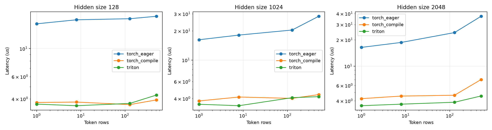

# Triton RMSNorm 算子实验

精度：bfloat16。GPU：NVIDIA GeForce RTX 4090。

同时对比 eager 和 torch.compile；下面是算子微基准，不代表完整推理加速。

| Rows | Width | Backend | 中位耗时 μs | 正确性 | 最大绝对误差 |
| --- | --- | --- | --- | --- | --- |
| 1 | 128 | torch_eager | 15.720 | True | 0 |
| 8 | 128 | torch_eager | 16.911 | True | 0 |
| 128 | 128 | torch_eager | 17.246 | True | 0 |
| 512 | 128 | torch_eager | 18.031 | True | 0 |
| 1 | 128 | torch_compile | 3.746 | True | 0.015625 |
| 8 | 128 | torch_compile | 3.775 | True | 0.03125 |
| 128 | 128 | torch_compile | 3.604 | True | 0.03125 |
| 512 | 128 | torch_compile | 3.925 | True | 0.03125 |
| 1 | 128 | triton | 3.637 | True | 0 |
| 8 | 128 | triton | 3.532 | True | 0 |
| 128 | 128 | triton | 3.683 | True | 0 |
| 512 | 128 | triton | 4.289 | True | 0 |
| 1 | 1024 | torch_eager | 16.211 | True | 0 |
| 8 | 1024 | torch_eager | 18.120 | True | 0 |
| 128 | 1024 | torch_eager | 20.436 | True | 0 |
| 512 | 1024 | torch_eager | 28.338 | True | 0 |
| 1 | 1024 | torch_compile | 3.779 | True | 0.03125 |
| 8 | 1024 | torch_compile | 4.149 | True | 0.03125 |
| 128 | 1024 | torch_compile | 4.020 | True | 0.0625 |
| 512 | 1024 | torch_compile | 4.395 | True | 0.0625 |
| 1 | 1024 | triton | 3.494 | True | 0 |
| 8 | 1024 | triton | 3.375 | True | 0 |
| 128 | 1024 | triton | 4.086 | True | 0 |
| 512 | 1024 | triton | 4.186 | True | 0 |
| 1 | 2048 | torch_eager | 16.399 | True | 0 |
| 8 | 2048 | torch_eager | 18.695 | True | 0 |
| 128 | 2048 | torch_eager | 24.236 | True | 0 |
| 512 | 2048 | torch_eager | 37.285 | True | 0 |
| 1 | 2048 | torch_compile | 4.238 | True | 0.03125 |
| 8 | 2048 | torch_compile | 4.536 | True | 0.03125 |
| 128 | 2048 | torch_compile | 4.637 | True | 0.0625 |
| 512 | 2048 | torch_compile | 7.017 | True | 0.0625 |
| 1 | 2048 | triton | 3.517 | True | 0 |
| 8 | 2048 | triton | 3.665 | True | 0 |
| 128 | 2048 | triton | 3.854 | True | 0 |
| 512 | 2048 | triton | 4.548 | True | 0.03125 |

逻辑带宽估计假设每行读取输入与权重、写回输出；并非硬件 DRAM 实测带宽。
Triton 实现保留 Qwen3 的 FP32 reduction 和归一化结果先回转输入 dtype 的舍入顺序。
原始重复测量、误差和环境在 measurements.json。
